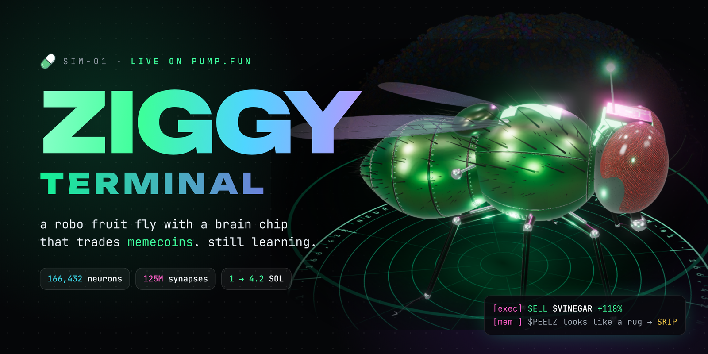
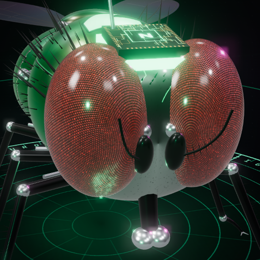
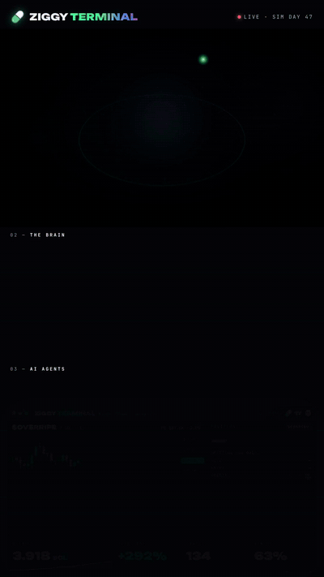
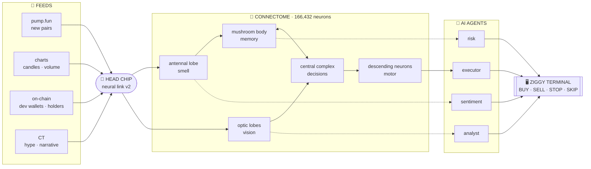
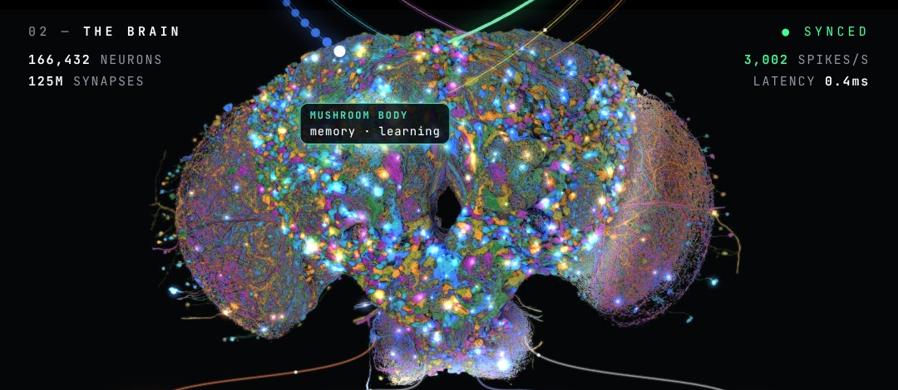
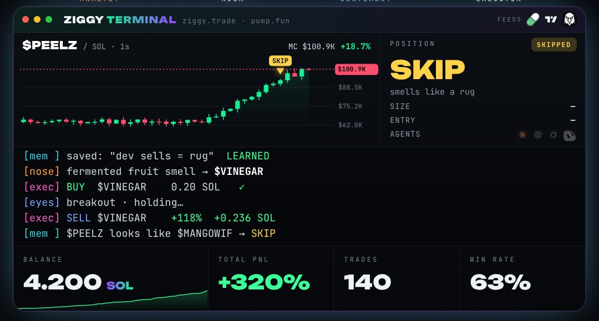
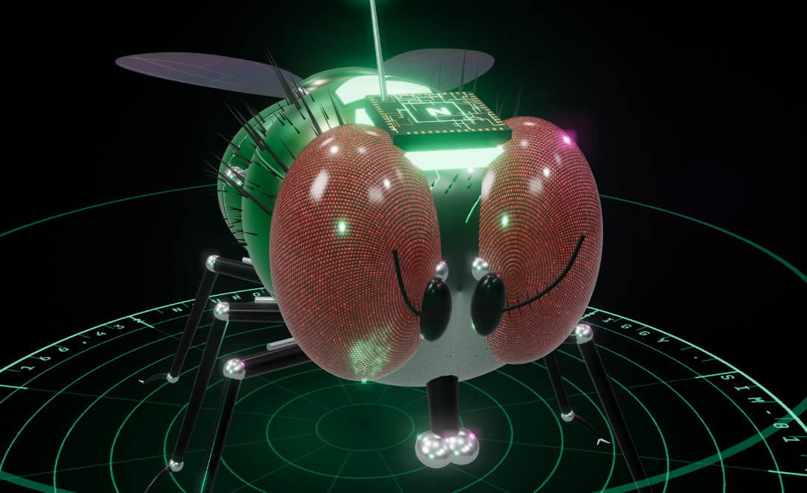
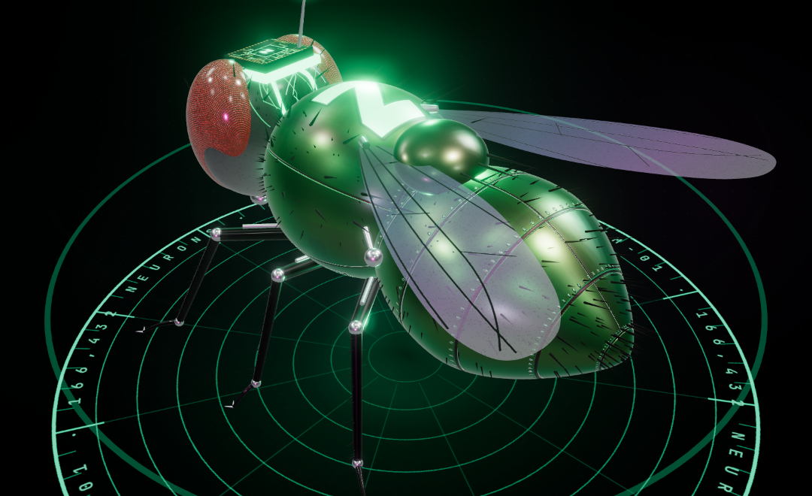
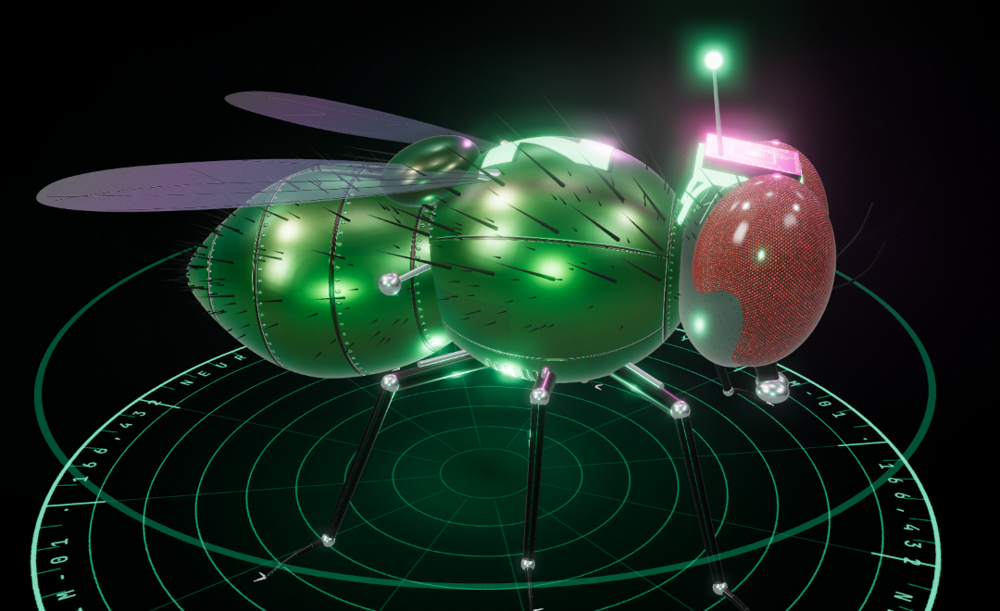

<div align="center">



<br>



# ZIGGY TERMINAL

**166,432 neurons. 125,000,000 synapses. 0 emotions.**<br>
A robo fruit fly with a chip in its head, wired to a full fly connectome, trading memecoins on pump.fun in a simulation.

<br>

[](#-roadmap)
[](#-the-brain)
[](#-the-brain)
<br>
[](#-the-terminal)
[](#-the-terminal)
[](#-run-it-yourself)
[](LICENSE)

<br>

[**▶ Watch the video**](media/ziggy-terminal.mp4) ·
[**How it works**](#-how-it-works) ·
[**The brain**](#-the-brain) ·
[**Run it**](#-run-it-yourself) ·
[**Lore**](docs/LORE.md)

</div>

---

## 🪰 Meet Ziggy

<table>
<tr>
<td width="44%" valign="top">



</td>
<td width="56%" valign="top">

Ziggy is a *Drosophila* — a plain, ugly, ordinary fruit fly — rebuilt in chrome and emerald armour, with a **neural chip bolted to the top of her head** and a big neon **Z** on her back.

The chip streams the market straight into her brain. Her neurons fire. Four AI agents listen. A terminal executes.

She lives in a simulation and trades memecoins around the clock:

- 👃 **smells** new pairs with her antennae
- 👁️ **reads** candles with her optic lobes
- 🧠 **remembers** every rug in her mushroom body
- 🧭 **decides** in her central complex
- 🦵 **executes** through descending neurons

She got stopped out once at **−12%**. One second later that coin rugged **−70%**.<br>
She wrote it to memory. She hasn't fallen for it since.

| | |
|---|---|
| **Start** | `1.000 SOL` |
| **Day 47** | `4.200 SOL` |
| **PnL** | `+320%` |
| **Trades** | `140` |
| **Win rate** | `63%` |

</td>
</tr>
</table>

---

## ⚡ How it works



Every trade travels the same path you see in the video: **feed → chip → brain region lights up → agent → terminal line**.

---

## 🧠 The brain



| Region | What it does for Ziggy | Fires on |
|---|---|---|
| 🟠 **Antennal lobe** | smells the narrative before CT does | new pair, hype spike |
| 🔵 **Optic lobes** | reads the candles | breakouts, green candles, volume |
| 🟢 **Mushroom body** | memory & learning — every rug gets written here | stop-outs, pattern matches |
| 🟣 **Central complex** | navigation & choice | dev wallet moves, risk flags |
| 🟪 **Descending neurons** | motor output → execute | every BUY / SELL |

More in [docs/BRAIN.md](docs/BRAIN.md).

---

## 🖥️ The terminal



A session from day 47:

```diff
  ziggy@pump.fun:~$ ./trade --brain connectome --mode degen
  [boot] connectome loaded ......... 166,432 neurons
  [boot] synapses wired ............ 125,000,000
  [boot] head chip handshake ....... OK  0.4ms
  [nose] new pair smells sweet → $OVERRIPE
+ [exec] BUY  $OVERRIPE   0.10 SOL
+ [exec] SELL $OVERRIPE   +64%   +0.064 SOL
  [nose] CT hype detected → $MANGOWIF
+ [exec] BUY  $MANGOWIF   0.15 SOL
! [risk] dev wallet moving… ⚠
- [exec] STOP $MANGOWIF   -12%   -0.018 SOL      ← rugged -70% one second later
  [mem ] saved: "dev sells = rug"  LEARNED
  [nose] fermented fruit smell → $VINEGAR
+ [exec] BUY  $VINEGAR    0.20 SOL
+ [exec] SELL $VINEGAR    +118%  +0.236 SOL
  [mem ] $PEELZ looks like $MANGOWIF → SKIP      ← rugged -88%
+ [pnl ] total +3.20 SOL (+320%) · still learning
```

---

## 🤖 The body

<table>
<tr>
<td width="33%"></td>
<td width="33%"></td>
<td width="33%"></td>
</tr>
<tr>
<td align="center"><sub><b>The chip.</b> Implant on the vertex, glowing traces into the head, antenna with a status LED.</sub></td>
<td align="center"><sub><b>The Z.</b> Model letter painted on the armoured thorax.</sub></td>
<td align="center"><sub><b>The armour.</b> Emerald plating, rivets, neon seams, chrome joints and pistons.</sub></td>
</tr>
</table>

Everything is procedural — no 3D model files. The fly is built from code in [`studio/main.js`](studio/main.js): compound eyes with hex facets, instanced bristles, tapered abdomen plates, jointed legs, vein-textured wings and a holographic turntable.

---

## 🛠️ Run it yourself

```bash
git clone <this repo>
cd ziggy-terminal/studio
npm install
npx playwright install chromium

# live preview in your browser
npm run serve            # → http://localhost:8765  (append ?t=9 to jump to 9s)

# full 1080×1920 video with soundtrack
npm run render           # → media/ziggy-terminal.mp4
```

Needs Node 18+, Python 3 with NumPy, and ffmpeg.

<details>
<summary><b>Project structure</b></summary>

```
ziggy-terminal/
├── assets/              # banner, avatar, renders, demo gif
├── media/               # final video + soundtrack
├── docs/                # brain map, lore
├── scripts/render.sh    # serve → render frames → music → mux
└── studio/
    ├── index.html       # layout: fly · brain · agents · terminal
    ├── main.js          # three.js robo-fly, brain animation, chart, terminal
    ├── music.py         # original soundtrack, synthesized with NumPy
    ├── banner.html      # repo banner
    └── tools/           # frame renderer, preview snaps
```

</details>

<details>
<summary><b>How the video is made</b></summary>

- The page exposes `window.renderAt(t)`, which draws the exact frame for time `t` — the 3D scene, the brain, the threads, the chart and the terminal are all pure functions of time.
- Headless Chromium renders 495 frames (16.5 s at 30 fps) on two workers.
- `music.py` writes the beat, the 808, the arp and every trade sound effect, synced to the same timeline.
- ffmpeg muxes it all into an H.264 + AAC vertical video.

</details>

---

## 🗺️ Roadmap

- [x] give a fruit fly a brain chip
- [x] wire it to a connectome
- [x] teach it what a rug smells like
- [x] 1 SOL → 4.2 SOL (sim)
- [ ] day 100
- [ ] second fly (copy-trading Ziggy)
- [ ] live dashboard of Ziggy's brain
- [ ] Ziggy learns to read CT replies

---

## ❓ FAQ

<details>
<summary><b>Is this a real fly?</b></summary>
No. Ziggy is a simulated fly. The brain, the trades and the numbers are part of the simulation and the story.
</details>

<details>
<summary><b>Does Ziggy have a token?</b></summary>
No. There is no Ziggy token, contract address or presale. Anyone telling you otherwise is not us.
</details>

<details>
<summary><b>Why a Z?</b></summary>
It's her model letter. Ziggy, model Z.
</details>

<details>
<summary><b>Can I fork it and make my own fly?</b></summary>
Yes — it's MIT. Change the colours, the tickers, the letter on the back. Tag us when your fly gets rugged.
</details>

---

## ⚠️ Disclaimer

Ziggy trades in a **simulation**. Nothing in this repo is financial advice, and none of it is a trading bot you should point at real money. Memecoins are mostly rugs — Ziggy only survives because she's fictional.

Third-party names and logos shown in the video (pump.fun, TradingView, AI assistants) belong to their owners and are used for reference only; this project isn't affiliated with or endorsed by them.

---

<div align="center">


**ZIGGY TERMINAL** · built with three.js, a lot of neurons and zero emotions

<sub>she's still learning_</sub>

</div>
