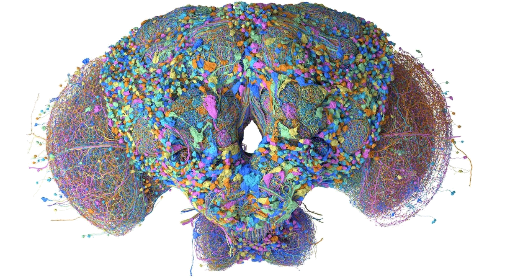

# 🧠 Ziggy's brain



Ziggy runs on a fruit-fly connectome: **166,432 neurons** and **125,000,000 synaptic connections**. The head chip doesn't replace any of it — it just feeds the market in and reads decisions out.

## Inputs → regions

| Feed | Enters through | Region | In trader terms |
|---|---|---|---|
| pump.fun new pairs | chip → antennae | **Antennal lobe** | "this one smells sweet" |
| CT posts | chip → antennae | **Antennal lobe** | narrative before the timeline catches up |
| candles, volume | chip → eyes | **Optic lobes** | breakout, three green candles |
| dev wallets, holders | chip → central brain | **Central complex** | "dev wallet moving… ⚠" |

## Memory

The **mushroom body** is where flies learn smells that end badly. For Ziggy that's rugs.

```
[exec] STOP $MANGOWIF  -12%
[mem ] saved: "dev sells = rug"  LEARNED
...
[mem ] $PEELZ looks like $MANGOWIF → SKIP
```

One bad trade → one memory → every lookalike gets skipped.

## Outputs → agents

| Region | Agent | Job |
|---|---|---|
| Optic lobes | **Analyst** | reads the chart |
| Central complex · mushroom body | **Risk** | stops, skips, memory |
| Antennal lobe | **Sentiment** | CT / narrative |
| Descending neurons | **Executor** | BUY · SELL |

## In the video

- **sparks** = individual spikes, sampled from the brightest cells of the render
- **waves** = a region activating on a trade signal
- **scan line** = the chip's read cycle
- the spike counter jumps on every signal
